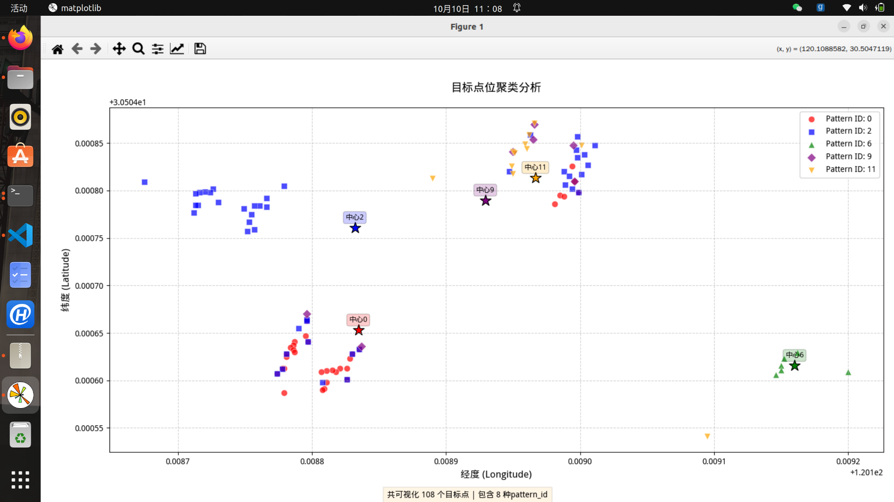
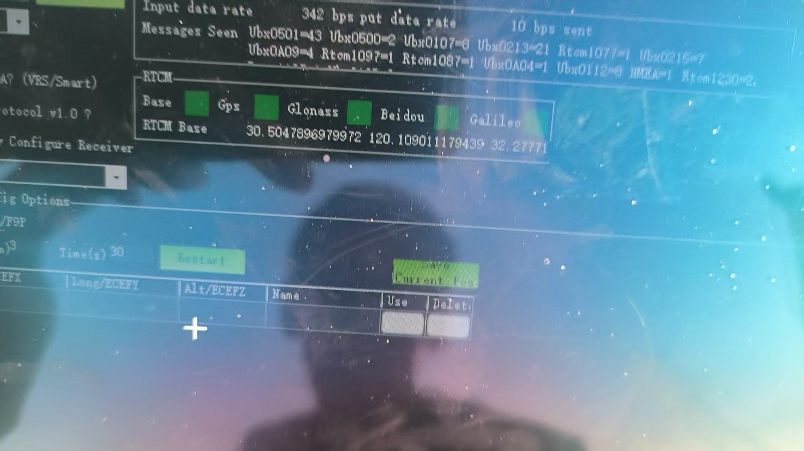

# 2025 曝光与定位技术记录

这里集中保留曝光条件、现场定位记录和两张分析图，不附大批照片、比赛总结或飞行调参过程。时间匹配原理及误差推导见 [图像与位姿对齐](../航电设计/02-图像与位姿对齐.md)。

## 1. 简短曝光记录

`曝光.docx` 的原文内容为：

```text
晴天/下午3点/
5200lux
较暗：3
较亮5
```

原文没有明确 3、5 的单位、含义和比较对象，因此不把它们直接写成毫秒曝光参数。

## 2. 原实验分组中的条件

下表来自原照片目录名称，用于保留试验条件；它们不是新的曝光拟合公式或效果验收结论。

| 日期分组 | 照度记录 | 曝光记录 |
|---|---|---|
| 9-7 | 5000 lux | 2 ms（压缩包记录） |
| 9-7 | 50000 lux | 2 ms |
| 9-9 | 32000 lux | 4 ms |
| 9-13 | 10000 lux | 25 ms |
| 9-13 | 13500 lux | 15 ms |
| 9-13 | 14000 lux | 10 ms |
| 9-13 | 20000 lux | 10 ms |

原资料还含“第一次靶标动”分组，没有明确照度和曝光值，不自行补值。上述记录没有提供统一相机增益、偏光镜、识别率或对照测量，不能据此承诺识别效果。

`杭州试飞信息备份.docx` 中关于偏光镜的原记录为：

> 曝光控制：70000-3200（5000）偏光镜参数xy=13000；？-800lux不加偏光镜参数xy=50000。

其中范围和 xy 参数的单位未说明，保留原不确定符号，不改写成可直接使用的标定关系。

## 3. 定位与聚类现场记录

同一现场文档记录：

> 旧版甲板识别散度5m左右，聚类得出2.9m，
>
> 使用新型甲板：识别精度有希望<1m

前一句是现场记录，缺少真值、样本和误差统计口径；后一句是预期，不是已验证的亚米级结论。

### 第一轮 B 组目标点分布



图中保留不同 Pattern ID 的点及聚类中心。没有配套真值与完整统计，本图不独立证明定位精度；不同 ID 混杂与离群点也一并保留。

### 同组资料中的 RTK 基站状态



原图保留基站参考信息，但没有足够记录将这张照片与每一个检测点逐时对应，因此不据此推断整段定位过程都处于同一种解状态。
