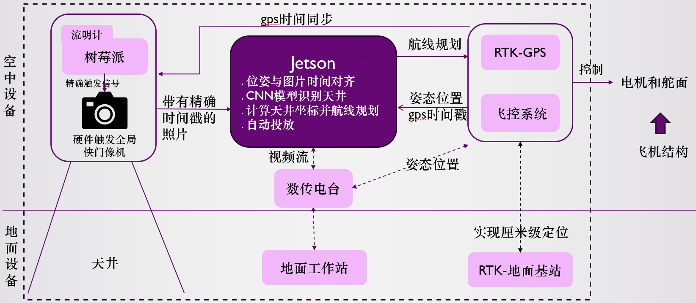
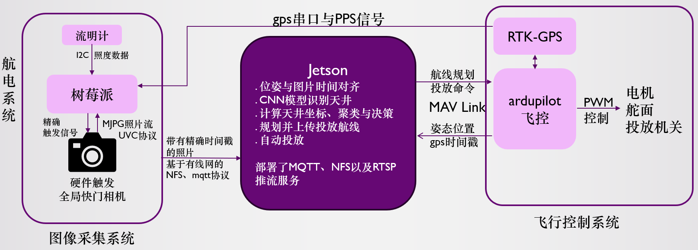
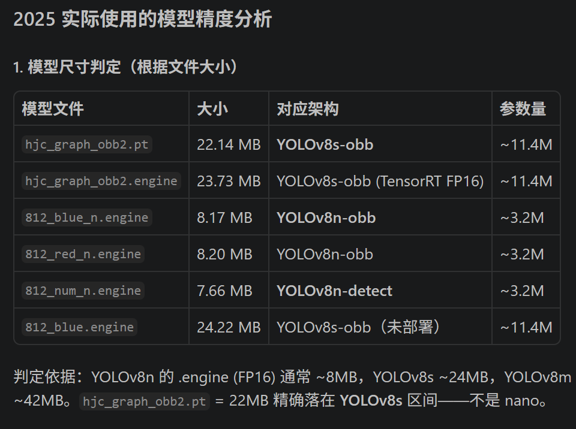

# 2025 系统架构

本文为 2025 实现与设计记录，保留当时的分析、未完成项及后续意见；“待补充”均为原文状态。

## 阅读顺序

先了解任务与设备分工，再沿任务流程阅读 Jetson、采集系统和模型设计，最后查看问题、未完成工作与复现入口。

## 目录

- [1. 项目任务](#architecture-1)
- [2. 系统架构与设备分工](#architecture-2)
- [3. 任务执行流程](#architecture-3)
- [4. Jetson 硬件连接与程序设计](#architecture-4)
- [5. 图像采集与回传](#architecture-5)
- [6. 模型、数据与原始分析图](#architecture-6)
- [7. 工程问题与改进方向](#architecture-7)
- [8. 环境搭建与未完成工作](#architecture-8)
- [9. 模拟器与开发笔记](#architecture-9)
- [10. 原始使用注意事项](#architecture-10)

## 1. 项目任务

我们需要制作一架固定翼无人机，可以自主起飞，在任务区域内识别数字或图像天井，然后决策向其中一个天井投放物资载荷(一瓶矿泉水)，并自主着落。在无人机起飞后的全流程中不允许对无人机进行任何操作行为。

## 2. 系统架构与设备分工

### 2.1 系统总览

架构示意图

主要分为**结构部分**、**航电部分**和**地面部分**（实际任务中地面部分只起到监控无人机状态作用）
航电系统通过飞控发出PWM信号控制无人机的电机转速和舵面

### 2.2 航电设备及其输入输出

- **Jetson**
核心的识别与任务规划模块
- **图像采集系统**
构成：树莓派5、硬件触发相机、流明计
输入：gps串口与PPS信号，用于生成精确触发信号
输出：通过**有线网**与Jetson连接，通过MQTT接收Jetson的控制信号，通过NFS协议向Jetson硬盘写入带有精确时间戳的图像数据
- **飞行控制系统**
构成：Ardupilot飞控(CUAV v5nano)、RTK-GPS(CUAV 9ps)、数传电台(如使用RTK的地面站功能)
输入：从Jetson接收MAVLink航线规划与投放命令
输出：高精度的位姿和GPS数据，通过串口向图像采集系统输出，通过MAVLink向Jetson输出

## 3. 任务执行流程

### 3.1 从准备到降落

- 预起飞阶段：相机预热、GPS定位获取、连通飞控、收敛RTK-GPS、载入侦察航点等
- 起飞阶段：自检完成后将播放音乐，操作手听到音乐后进行抛飞
- 侦察阶段：jetson接收带有精确时间戳的图像和位姿数据，运行yolo识别，反解靶标坐标，进行聚类分析
- 打击阶段：根据侦查阶段的聚类结果，选择最终打击目标及其坐标，规划并上传打击航线。之后实时计算投弹弹道，实现精确投弹
- 降落阶段：在投弹结束后，上传降落航线，完成任务

### 3.2 启动操作

上电开机，飞控会首先切到MANUAL（如果飞快开机时不是manual的话），
听到第一段音乐播放，说明自检完成，可以切模式到AUTO并解锁

完整操作步骤见[系统启动与操作流程](../使用说明/系统启动与操作流程.md)。

## 4. Jetson 硬件连接与程序设计

主要使用python实现

### 4.1 硬件连接

- 通过usb连接ardupilot飞控，在串口上允许MAVLink协议；
- 通过以太网连接树莓派，作为MQTT、NFS Server控制树莓派开始图像采集、接收图像(图像名称就是时间戳)、停止图像采集
- (可选)通过以太网连接数传电台，作为RTSP服务器推流

### 4.2 服务与运行环境

- AI infra：NVIDIA JetPack SDK（包含驱动、CUDA等）
- python环境：
有一部分是预安装的，如没有安装，通过JetPack SDK安装
以下列出的是重要的包，并未列出所有包
    - AI相关：TensorRT(预安装，用于转换与加速模型)、torch、torchvision、**ultralytics**(yolo模型库)
    - 图像相关：**opencv**(用于图像处理以及RTSP推流)
    - MAVLink相关：**dronekit**
    - MQTT相关：paho-mqtt
- service：
    主要通过systemctl配置
    - MQTT
    - NFS
    - RTSP(Mediatx)，**在目前的实现中是由rtsp.py进程启动的**，也可以改为开机自启动

### 4.3 程序目录与配套文件

- config文件夹：存储的json格式配置，由configuration.py读取，用于配置任务中的各类参数
- log: 各个模块打印出的日志统一存储在这里，日志用logging包统一打印
- model: 存储图像识别模型
- note: 有兴趣看看，有一些关于ardupilot sitl模拟器和dronekit的笔记
- picture_test: 保存了一些用于测试yolo.py的图片
- picture_nfs: 如没有需要创建，nfs保存图片的文件夹
- waypoint: 预设的航线，如起飞、搜索、降落(以及默认投放)，投放航线需要实时计算

### 4.4 程序模块

- 带_test后缀的是测试程序，不用去管
- configuration.py: 用于读取config文件下的配置文件，并传入每个模块配置参数
- detect.py: detect_aligner()负责把位姿数据和图像数据按照时间戳对齐，传给yolo识别模块，并同时启动detect_receiver()线程，对识别到的结果聚类分析，在得到最终的投放目标的时候，或者detect.shutdown_event最终返回
- 模块说明待补充。

以上路径均相对 [Jetson 程序目录](../程序/jetson/README.md)。

### 4.5 源码阅读入口

原文的模块说明未写完；下面补充文件入口，便于继续阅读实现，不替代原分析。

| 阅读顺序 | 文件 |
|---|---|
| 主入口与配置 | [main.py](../程序/jetson/main.py)、[configuration.py](../程序/jetson/configuration.py) |
| 飞控与位姿 | [navigate.py](../程序/jetson/navigate.py) |
| 图像通知与时间匹配 | [mqtt_receiver.py](../程序/jetson/mqtt_receiver.py)、[detect.py](../程序/jetson/detect.py) |
| 识别与坐标反解 | [yolo.py](../程序/jetson/yolo.py)、[locate.py](../程序/jetson/locate.py) |
| 航线与任务 | [routeplan.py](../程序/jetson/routeplan.py)、[mission.py](../程序/jetson/mission.py) |
| 投放预测 | [trajectory.py](../程序/jetson/trajectory.py) |
| 视频推流 | [rtsp.py](../程序/jetson/rtsp.py) |

## 5. 图像采集与回传

见CUADC-rpi5仓库

本资料包中的入口：[树莓派采集程序与部署](../程序/rpi5/README.md)、[图像与位姿对齐](02-图像与位姿对齐.md)。

## 6. 模型、数据与原始分析图

- 2024训练的模型
812_red_n.pt(识别红色靶标，基于yolov8n-obb)
812_blue_n.pt(识别浅蓝色靶标，基于yolov8n-obb)
812_num_n.pt(识别截取出的靶标上的数字，基于yolov8n-obb)
评估：**812_blue_n.pt无法处理2025年深蓝色靶标的情况**
2024届基于v8s训练的模型表现普遍不如v8n，特别是在有天井干扰的情况下
- 2025训练的模型
1011_dark_blue_n.pt(识别2025年深蓝色靶标，基于v8n，数据集全都是自动生成的，但是效果意外地不错。在10月11日比赛当天凌晨一点训的)
hjc_graph_obb*.pt(直接在原始图像上识别2025年的12种图案靶标)
**实践证明直接在原始图像上识别并做12分类效果不行，更好的方法还是先截取靶标(不论是yolo-obb还是openCV的多边形提取)，然后再进行12分类是更好的选择**
- 2025数据集
data_blue_tianjing(1011_dark_blue_n.pt的数据集)
TestT3、UD4p以及1007是图像识别的数据集。**但是后续要再用新方案(双层识别)的话，大概需要再对这些数据集处理一下，比如截取出旋转框对应的图像区域构建出新的数据集**

(模型训练的环境搭建、数据标注和模型训练的文档待补充)
(使用ardupilot sitl的文档、地面测试的文档待补充)

### 6.1 原始模型分析图片

图中主要保留按文件体积判断模型架构与参数量的过程；图内标题沿用原文，不将其作为新增的精度测试结果。

## 7. 工程问题与改进方向

note: 下面这些问题很多都不是和代码本身有关的

- 与飞控通信：上传航点任务、接收姿态、速度和位置等消息的数据包。通过串口。（**attention：可以尝试不通过usb口而通过telem口获得更高频率的传感数据，但需要注意飞控是否会过载。这点我们也不确定。飞控usb口的数据流频率参数(sr0_extra姿态、sr0_position位置)不论怎么设置，用dronekit回调实测都是4hz**）
(**额外难点：如何在复杂电磁环境下实现RTK定位(有GPS、数传频点干扰)。设置有效信号高度角？**)
之后程序通过EKF对这些数据信息进行插值，获取和图像时间戳一致的时间点的位姿信息(**难点：EKF插值的调参，目前采用的还是线性插值，不过EKF插值的代码也写了，在navigate.py中把LinearEKF改为PoseEKF即可**)
- 与摄像头/树莓派通信：确认树莓派正常启动，发送启动拍摄与结束拍摄的指令，接收带有精确时间戳的照片(**难点：无，已经都被解决了，树莓派5刷上sd卡接好线，连上摄像头、流明计和gps、pps就能用。详情见cuadc-rpi5项目，查打图像收集解决方案**)
- 利用上面得到的信息，跑yolo识别，根据位姿数据和目标在图像中的位置进行反向解算出目标的id和经纬度坐标(**难点：数据收集与模型训练，以及反解的精度问题，这个精度与图像拍摄、摄像头安装角度、光轴偏差和飞控数据都有关系**)
- 对识别到的目标进行聚类分析，确认实际的目标id与坐标(难点：无，利用sklearn库即可解决)
- 在确认目标后，规划打击航线进行打击，不断读取飞控输出的位置和姿态信息进行投弹判断(**难点：如何从飞控获取更高频率的数据流(lua脚本？)，以及校准correct_t投弹延时**)
- 投弹后上传降落航点，结束(**难点：如何在顺风、逆风、侧风的复杂条件下成功降落到指定区域。涉及到飞控降落调参、航线规划与高度数据源选择**)

其他问题及后续优化的原文合并稿见 [2025 技术复盘](../../2025反思优化/2025反思与后续优化.md)。

## 8. 环境搭建与未完成工作

待补充
内容：JetPack、各个python包、mediatx服务器、NFS服务导出picture_nfs文件夹、MQTT服务器，以及该程序的开机自启动

## 9. 模拟器与开发笔记

见该项目note文件夹下note_navigate.md

本资料包中的入口：[SITL、航点与 DroneKit 笔记](../程序/jetson/note/note_navigate.md)、[开发与配置记录](../程序/jetson/note/README.md)。

## 10. 原始使用注意事项

检查配置文件和land.waypoints中的坐标位置是否是同一个飞场
检查代码中带有attention注释的部分
**不要直接使用该项目代码！！！在模拟器上做好测试、充分理解每个模块后再上真机！！！**
